<picture>
  <source media="(prefers-color-scheme: dark)" srcset="assets/banner-dark.svg">
  
</picture>

 

---

### 🧭 关于我

> 从「看得懂」到「做得出」，中间隔着的每一行代码都算数。

- 🎓 **在校学生**，正在系统学习 **Python** 与 **AI（LLM / PyTorch）**
- 🧪 学法是「边做边学」：每学完一块内容，就写一个小工具或一份笔记放上来
- 🌱 这个主页会跟着项目一起生长 —— 你现在看到的是第 1 版

---

### 🧱 技术栈

**语言与基础**

**AI 与数据**

**工具**

---

### 🗺 学习路线

<!-- 状态按实际情况改：✅ 已掌握 / 🚧 进行中 / ⬜ 计划中 -->

| 阶段 | 主题 | 状态 |
| :--: | :--- | :--: |
| 01 | Python 语法、数据结构与面向对象 | 🚧 进行中 |
| 02 | 数据结构与算法基础 | ⬜ 计划中 |
| 03 | NumPy / Pandas 数据处理 | 🚧 进行中 |
| 04 | PyTorch 入门：张量、自动求导、训练循环 | 🚧 进行中 |
| 05 | LLM 应用：Prompt、RAG、Agent | 🚧 进行中 |
| 06 | 完整项目：从训练到部署 | ⬜ 计划中 |

---

### 🚀 项目

> 🧪 **第一个项目正在打磨**：用 PyTorch 复现一个小模型，把「训练 → 评估 → 导出」的流程完整走通。
> 仓库公开后会自动出现在这里，并被固定到主页的 Pinned 区域。

<!-- 有仓库后，把下面模板的注释去掉并按实际填写，或直接删掉这段留白：

| 项目 | 一句话说明 | 技术 |
| :--- | :--- | :--- |
| [项目名](https://github.com/HH200606/仓库名) | 解决了什么问题、有什么可看的 | Python · PyTorch |
-->

---

### 📊 GitHub 数据

展开看活跃数据（会随贡献自动更新）

 

  
  

  

---

### 📫 联系

- GitHub：[**@HH200606**](https://github.com/HH200606) —— 最直接的方式是在仓库里提 Issue
- 想聊的：AI Agent、LLM 应用落地、Python 工程化，以及「怎么从零开始」
- 还在找第一份实习方向，欢迎交流 👋

 

把每天学到的东西留下痕迹。

